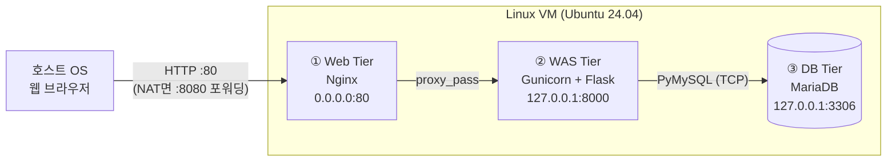

# 10주차 과제 — 리눅스 VM 3-Tier 로그인 서비스

리눅스 가상머신 한 대에 **Web – WAS – DB** 3계층을 구성하고, 호스트 OS 웹 브라우저에서 ID/PW 로 로그인하는 서비스.



| 계층 | 구성 요소 | 역할 | 접근 범위 |
|---|---|---|---|
| Web (Presentation) | Nginx | 정적 파일 제공, 리버스 프록시, 로그인 요청 수 제한, 보안 헤더 | `0.0.0.0:80` (외부 공개) |
| WAS (Application) | Gunicorn + Flask | 로그인·회원가입·세션·CSRF 처리, 비밀번호 해시 | `127.0.0.1:8000` (VM 내부) |
| DB (Data) | MariaDB | `users`, `login_logs` 저장, 최소 권한 계정 | `127.0.0.1:3306` (VM 내부) |

## 디렉터리

```
week10/
├── web/      nginx-loginapp.conf, static/style.css, 50x.html   ← Web Tier
├── app/      app.py, gunicorn.conf.py, requirements.txt, templates/  ← WAS Tier
├── db/       schema.sql, 60-loginapp.cnf                        ← DB Tier
├── deploy/   setup.sh (자동 설치), loginapp.service (systemd)
├── tests/    e2e_test.sh (curl 기반 28개 항목)
└── report/   보고서 HTML/PDF, 스크린샷
```

## 설치 (VM 안에서)

```bash
git clone https://github.com/th0079/system.git
```

```bash
sudo bash system/week10/deploy/setup.sh
```

끝나면 접속 주소와 데모 계정(`demo` / `Demo1234!`)이 출력된다. 회원가입 화면에서 새 계정도 만들 수 있다.

## 호스트 OS 에서 접속하기

| 하이퍼바이저 / 네트워크 | 설정 | 브라우저 주소 |
|---|---|---|
| VirtualBox **NAT** (기본값) | 설정 → 네트워크 → 어댑터1 → 고급 → 포트 포워딩: TCP, 호스트 `127.0.0.1:8080` → 게스트 `80` | `http://localhost:8080` |
| VirtualBox **호스트 전용 어댑터** | 어댑터2 를 "호스트 전용 어댑터"로 추가, VM 에서 `ip -4 addr` | `http://192.168.56.x` |
| VMware **NAT** / **브리지** | 추가 설정 없음, VM 에서 `ip -4 addr` | `http://<VM IP>` |
| UTM (Mac) Shared Network | 추가 설정 없음 | `http://192.168.64.x` |

## 테스트

```bash
sudo bash system/week10/tests/e2e_test.sh
```

호스트 OS 에서도 실행 가능: `bash tests/e2e_test.sh http://localhost:8080`

## 계층별 확인 명령어

```bash
sudo systemctl status nginx loginapp mariadb --no-pager
```

```bash
sudo ss -ltnp | grep -E ':(80|8000|3306)\b'
```

```bash
sudo mysql -e "SELECT username, LEFT(password_hash, 30) AS hash, created_at FROM loginapp.users"
```

## 트러블슈팅

| 증상 | 원인 | 해결 |
|---|---|---|
| 호스트 브라우저에서 접속 안 됨 | NAT 포트 포워딩 미설정 / 방화벽 | 위 표대로 포워딩 설정, `sudo ufw allow 80/tcp` (Rocky: `firewall-cmd --add-service=http --permanent && firewall-cmd --reload`) |
| "WAS(Application Tier)에 연결할 수 없습니다" (502) | Gunicorn 중지 | `sudo systemctl restart loginapp`, `sudo journalctl -u loginapp -n 50` |
| "DB 서버(DB Tier)에 연결할 수 없습니다" (503) | MariaDB 중지 / 계정 비밀번호 불일치 | `sudo systemctl restart mariadb`, `setup.sh` 재실행 |
| setup.sh 가 "80번 포트 사용 중" | apache2/httpd 가 이미 실행 중 | `sudo systemctl disable --now apache2` |
| setup.sh 가 "root 로 접속할 수 없습니다" | MariaDB root 비밀번호를 따로 설정함 | `sudo MYSQL_ROOT_PASSWORD='비번' bash deploy/setup.sh` |
| Rocky 에서 502 | SELinux 가 Nginx→8000 연결 차단 | `sudo setsebool -P httpd_can_network_connect 1` (setup.sh 가 자동 처리) |
| 429 Too Many Requests | 로그인 페이지 요청 제한(초당 1회, 순간 30회) | 잠시 후 재시도 |

## 검증 범위

- Ubuntu 24.04 + systemd 환경에서 `setup.sh` 실행 → E2E 28/28 통과, 재시작 후 3개 서비스 자동 기동 확인.
- 외부 IP 에서 80 포트만 접속되고 8000·3306 은 거부되는 것 확인.
- Rocky Linux 9 분기(dnf, firewalld, SELinux)는 코드만 작성했고 **실행 검증은 하지 못함**.
